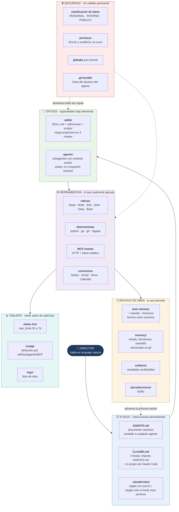
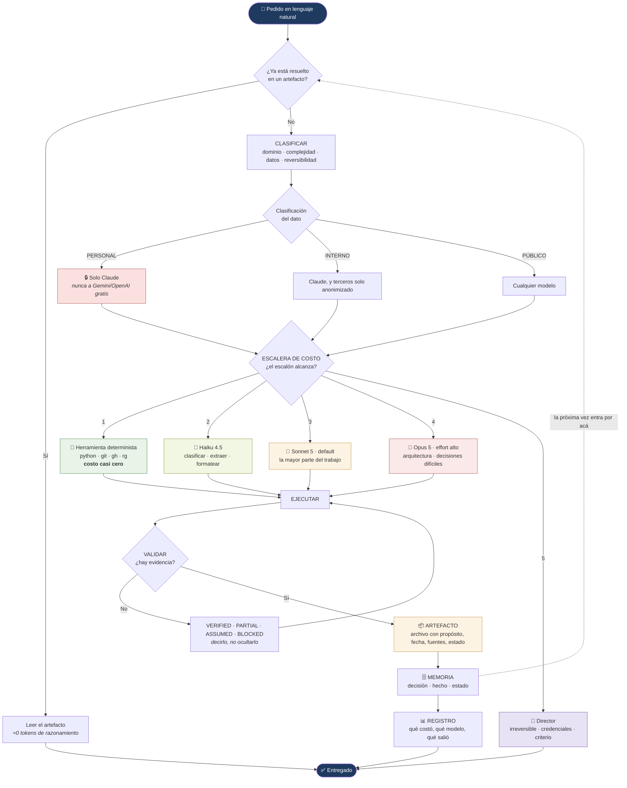

# ARCHITECTURE.md — Bruno AI OS

| Campo | Valor |
|---|---|
| Propósito | Arquitectura objetivo, derivada de la auditoría y la investigación verificada |
| Fecha | 2026-09-16 |
| Versión | 1.1 — aprobada y construida |
| Fuentes | `SYSTEM_AUDIT.md`, `docs/research/FINDINGS.md`, `PROGRESS.md` |
| Estado | `PARTIALLY VERIFIED` — implementada en las fases 1 a 10. La capa de seguridad queda parcial por decisión registrada (ADR-0009): no hay aislamiento |

---

## 1. La decisión central: esto no es un programa

El mandato propuso un diagrama razonable: interfaz → router → Claude/Gemini/OpenAI → orquestador → agentes/skills/MCP → artefactos → memoria. Es la arquitectura correcta **para alguien que paga APIs por token**.

La auditoría demuestra que el Director no está en ese caso, y hay dos hechos que lo cierran:

1. **Una suscripción no es una API key.** Claude Pro no expone endpoints facturables; el Agent SDK exige explícitamente `ANTHROPIC_API_KEY` de pago y Anthropic prohíbe usar el login de claude.ai para agentes construidos sobre él. **No hay nada que un router pueda rutear.** Por eso LiteLLM, OpenRouter, RouteLLM y `claude-code-router` se descartan como categoría entera, no uno por uno.
2. **El orquestador ya existe y ya está pago.** Claude Code trae subagentes con contexto aislado, skills con carga progresiva, hooks deterministas, permisos, memoria automática y medición de consumo por componente. Escribir otro orquestador encima sería reconstruir, peor y con presupuesto ajeno, algo que ya funciona.

> **Bruno AI OS no es software que se ejecuta. Es un repositorio estructurado que se lee.**
>
> *Analogía de obra:* no estamos fabricando una máquina. Estamos armando el **pliego, los planos, las especificaciones técnicas y el archivo de obra** de una empresa constructora que ya tiene las cuadrillas contratadas. El valor no está en una herramienta nueva: está en que cualquier cuadrilla que entre mañana encuentre todo escrito, ubicado y versionado.

Lo que sí se construye: el pliego (instrucciones), los oficios (skills), el archivo de obra (memoria y artefactos), el tablero de consumo (observabilidad), las reglas de seguridad y una tabla de ruteo. Nada de eso necesita un runtime propio.

### Qué se gana con esta forma

| Principio del mandato | Cómo lo cumple |
|---|---|
| Simplicidad | Cero runtime propio, cero servicios, cero base de datos |
| Seguridad | Menos superficie: no se instala Node ni contenedores |
| Fiabilidad | Si Claude Code cambia, el contenido sigue siendo markdown legible |
| Interoperabilidad | `AGENTS.md` + skills en formato estándar viajan a Gemini, Codex, Cursor |
| Reutilización | Todo es texto versionado |
| Ahorro de contexto | Carga progresiva y condicional en cada capa |
| Mantenibilidad | El Director puede leer y entender cada pieza |

---

## 2. Vista de capas — qué es Bruno AI OS



**Cómo leerlo, capa por capa:**

| Capa | Qué es | Por qué existe | Analogía de obra |
|---|---|---|---|
| **Pliego** | Instrucciones que rigen siempre | Sin contrato escrito, cada sesión improvisa | El pliego de condiciones: se firma una vez y rige toda la obra |
| **Oficios** | Procedimientos por tipo de tarea | Un albañil no necesita el manual del electricista | Los gremios: cada uno con su cuadernillo |
| **Archivo de obra** | Lo que sobrevive a la conversación | La charla se borra; el plano queda | El archivo de planos y actas |
| **Herramientas** | Lo que produce cambios reales | Preferir lo determinista a lo probabilístico | Las máquinas: siempre hacen lo mismo |
| **Tablero** | Consumo y resultados | No se administra lo que no se mide | El pizarrón de avance y costos |
| **Seguridad** | Reglas que atraviesan todo | Hoy no hay vallado perimetral | Los EPP y el control de acceso |

---

## 3. Vista de flujo — cómo trabaja una tarea



Las dos flechas punteadas son el corazón del sistema. La de arriba: **antes de razonar, buscar si ya está resuelto.** La de abajo: **cada tarea deja el terreno mejor preparado para la siguiente.** Sin esas dos, esto sería un chatbot con carpetas.

---

## 4. Ruteo de modelos — una tabla, no un programa

El "router" del mandato se implementa como **regla escrita + configuración nativa**, porque el cambio de modelo real ocurre con `/model`, con el campo `model:` del frontmatter de un subagente, y con los niveles de effort. No hay código que escribir.

### Escalera de costo

> Herramienta determinista → Haiku 4.5 → Sonnet 5 → Opus 5 → Director.
> **Se sube un escalón solo cuando el anterior falló o es demostrablemente insuficiente.**

### Tabla de asignación

| Tipo de trabajo | Escalón | Por qué |
|---|---|---|
| Buscar, contar, mover, versionar, formatear | Herramienta | Determinista y gratis. `ripgrep` no alucina |
| Clasificar, extraer campos, resumir un documento corto, renombrar | **Haiku 4.5** | Barato. No soporta effort: no pedirle razonamiento |
| Escribir, editar código, investigar, documentar, la obra diaria | **Sonnet 5** | Default de Claude Code en Pro. 1M nativo sin credits |
| Arquitectura, decisiones con trade-offs, depuración difícil, revisión adversarial | **Opus 5** con effort `high`+ | El más fuerte disponible en Pro, con sub-límite propio: es recurso escaso |
| Autenticación, credenciales, compras, BIOS, borrados, publicar | **Director** | Irreversible o fuera del alcance del agente |

### Configuración objetivo

| Ajuste | Valor | Razón |
|---|---|---|
| Modelo de sesión | `sonnet` (u `opusplan`) | `opusplan` planifica con Opus y ejecuta con Sonnet |
| Modelo de subagentes | `haiku` salvo justificación | Los subagentes son donde se multiplica el gasto |
| `effort` | `high` por defecto; `low` en etapas mecánicas | Los tokens de razonamiento se facturan como output |
| Fast mode | Deshabilitado | Requiere usage credits |
| Fable 5/5.1 | Excluido del selector | Requiere usage credits |
| Contexto 1M en Opus | No asumir. **Diseñar para 200K** | Es chequeo de *entitlement*, no de cuota |

### Regla de multiagente

> Fan-out de agentes **solo** para investigación de lectura, breadth-first, con ramas independientes.
> **Nunca** para tareas con estado compartido ni para escribir código en paralelo.
> **Costo medido: ~15x** un agente único. Los agent teams declaran ~7x y quedan deshabilitados.

Esta regla no salió de un paper: salió de que el primer fan-out de esta misma fase **agotó la ventana de 5 horas del plan**.

---

## 5. Clasificación de datos — la regla que Google nos obligó a escribir

Los términos del free tier de Gemini dicen que Google usa los prompts para mejorar sus productos, que revisores humanos pueden leerlos, y que no hay que enviar información sensible, confidencial o personal. Eso convierte la clasificación de datos en un **control de arquitectura, no en una política de escritorio**.

| Clase | Qué incluye | Dónde puede ir |
|---|---|---|
| 🔴 **PERSONAL** | Finanzas, documentos legales, correo, salud, datos del campo, identidades, credenciales | **Solo Claude** (servicios pagos del Director). Jamás a un tier gratuito de terceros |
| 🟡 **INTERNO** | Notas, borradores, código propio, planificación | Claude. A terceros **solo anonimizado y con decisión explícita** |
| 🟢 **PÚBLICO** | Documentación pública, artículos, código open source | Cualquier modelo |

Cada artefacto lleva su clase en el frontmatter. Sin clase declarada, se asume **PERSONAL**.

---

## 6. Economía de contexto — el protocolo de sesión

Derivado de hechos verificados, no de intuiciones.

1. **Trabajar en ráfagas.** El TTL del cache en suscripción es de **1 hora**. Turnos separados por menos de una hora reutilizan el prefijo a 0.1x; volver después de una hora reprocesa todo a precio completo.
2. **Ordenar de estable a volátil.** Instrucciones e índices primero, lo que cambia al final. Cualquier cambio arriba invalida todo lo de abajo.
3. **`/clear` + `HANDOFF.md`, no auto-compact.** Antes de cerrar un tramo se escribe el estado, las decisiones y el próximo paso. El turno siguiente arranca en ~1–2k tokens en vez de arrastrar 150K. La compactación cuesta una request grande y **pierde todo lo que solo existió en la conversación**.
4. **Si importa, está en un archivo.** Lo que sobrevive a la compactación se re-inyecta desde disco: `CLAUDE.md` raíz, rules sin `paths:`, auto memory, plan. Nada más.
5. **Reglas condicionales.** Todo lo que no se necesita siempre va a `.claude/rules/` con `paths:`, no a `CLAUDE.md`.
6. **Pocas skills, bien descritas.** Las descripciones de todas las skills están siempre en contexto: cada skill nueva es un impuesto fijo sobre cada sesión.
7. **Artefacto antes que razonamiento.** Si la respuesta ya existe en un archivo, se lee.
8. **Medir antes de optimizar.** `/usage` reporta el porcentaje servido desde cache, los misses y la atribución por componente.

---

## 7. Memoria — tres almacenes con oficios distintos

No hay una "memoria". Hay tres, y confundirlas es la causa habitual de sistemas que recuerdan lo que no importa y olvidan lo que sí.

| Almacén | Dónde | Qué guarda | Se carga |
|---|---|---|---|
| **Auto memory** | `~/.claude/projects/<p>/memory/` | Quién es el Director, cómo trabajar con él, restricciones del entorno, estado del proyecto | Índice `MEMORY.md` (**máx. 200 líneas / 25 KB**); los archivos temáticos, bajo demanda |
| **Memoria del repo** | `memory/` en el repositorio | Estado de obra, handoffs, decisiones, aprendizajes | Bajo demanda, versionada en git |
| **Artefactos** | `artifacts/` | Resultados reutilizables: informes, análisis, especificaciones | Bajo demanda |

Además, **el historial de git es memoria episódica gratis**: qué cambió, cuándo y por qué, sin construir nada.

**Taxonomía en frontmatter** (la que Claude Code ya entiende): `user`, `feedback`, `project`, `reference`.

### Sobre embeddings y bases vectoriales — decisión: no

El umbral medido está en **~1.500–2.000 documentos markdown (30–50 MB de prosa)**. Una base personal realista arranca en decenas o pocos cientos. El Director está **dos órdenes de magnitud por debajo**.

Además hay un argumento en contra que no es de costo sino de calidad: la evidencia de *context rot* muestra que **los documentos casi-relevantes degradan el resultado más que la falta de documentos**. Un buscador semántico que devuelve 5 "parecidos" puede rendir peor que un `ripgrep` que devuelve 1 exacto.

> **Señal de reconsideración** — cuando se cumplan **las dos** a la vez: (a) más de 1.500 archivos en `memory/` + `artifacts/`, y (b) búsquedas que fallan de forma reiterada porque son conceptuales y no léxicas. Queda anotado en `ARCHITECTURE_EVOLUTION.md`.

---

## 8. Herramientas — preferencia explícita

| Prioridad | Vía | Cuándo |
|---|---|---|
| 1 | **Nativas de Claude Code** | Siempre que alcancen. Read/Write/Edit/Glob/Grep cubren todo el filesystem |
| 2 | **CLI determinista** (`git`, `gh`, `python`, `rg`) | Acciones con resultado exacto y verificable |
| 3 | **Conectores de claude.ai** | Notion, Gmail, Drive, Calendar — ya autenticados |
| 4 | **MCP remoto por HTTP con token estático** | Cuando hace falta una integración que los anteriores no cubren |
| 5 | **MCP local en Python** | Último recurso. Solo `fetch` tiene valor real; versión pineada |
| ❌ | **MCP vía npx / Node / Docker** | No se instala. Ver ADR-0005 |

**Los 4 conectores rotos no se reparan: se reemplazan.** El error `does not support dynamic client registration` es una negociación OAuth que falla del lado del cliente, sobre una práctica que la propia spec de MCP acaba de deprecar. Ningún cambio local lo resuelve. GitHub tiene endpoint MCP remoto que acepta un PAT por header — y además `gh` ya está autenticado y es más barato en tokens.

---

## 9. Artefactos — convención

Todo artefacto relevante lleva encabezado:

```
Propósito · Fecha · Versión · Clasificación · Fuentes · Estado · Relaciones
```

Estados permitidos, sin excepción: **`VERIFIED` · `PARTIALLY VERIFIED` · `ASSUMED` · `BLOCKED`**.

Nombres: `kebab-case`, con fecha `YYYY-MM-DD` cuando el artefacto sea fechado. Rutas siempre con barra normal, incluso en Windows (la documentación marca las rutas estilo Windows como antipatrón explícito).

---

## 10. Seguridad — diseñar sabiendo que no hay muro

La postura completa está en `docs/security/THREAT_MODEL.md`. El resumen arquitectónico:

- **No hay aislamiento en uso.** La virtualización se habilitó en el firmware el 2026-09-15, pero WSL2 está diferido (ADR-0009): sin WSL2, sin Windows Sandbox, sin Docker. Y Claude Code no tiene sandbox de Bash en Windows nativo.
- **Las reglas de permisos son fricción y auditoría, no un muro.** Matchean el comando tal como está escrito.
- **Por lo tanto la defensa es de diseño, no de perímetro:** romper la trifecta letal separando roles. El agente que navega la web devuelve texto estructurado y **no tiene tokens ni ejecuta acciones**. El agente que actúa **no lee contenido no confiable**.
- **Los secretos no viven en archivos.** Credential Manager vía `keyring`, `gh auth`, y `gitleaks` en pre-commit.
- **El backup vive fuera del alcance del agente.**

---

## 11. Interoperabilidad

| Pieza | Formato canónico | Por qué |
|---|---|---|
| Instrucciones | **`AGENTS.md`** + `CLAUDE.md` como puntero de 3 líneas | Formato abierto con +60k repos. Una sola fuente de verdad. En Windows no se puede symlinkear sin admin: se usa import |
| Capacidades | **`SKILL.md`** estándar en `.claude/skills/` | Claude Code no escanea `.agents/skills/`; se proyecta una copia ahí cuando haga falta otro cliente |
| Conocimiento | **Markdown + git** | Legible por cualquier agente, por cualquier persona y por `grep` |
| Datos | **JSON / CSV** | Sin formatos propietarios |

Nada del núcleo depende de un proveedor. Si Claude desapareciera mañana, el repositorio sigue siendo un cuerpo de conocimiento usable.

---

## 12. Lo que deliberadamente NO se construye

Respuesta anticipada a la auditoría adversarial del mandato §33. Cada descarte tiene su razón; todos son revisables con evidencia.

| Candidato | Decisión | Razón |
|---|---|---|
| Base vectorial / RAG / embeddings | **No** | Dos órdenes de magnitud por debajo del umbral. Y los distractores degradan más que la ausencia |
| Router de modelos (LiteLLM, OpenRouter…) | **No** | Una suscripción no es una API key: no hay nada que rutear |
| Framework multi-agente (crewAI, langgraph…) | **No** | Asumen API keys facturadas por agente. Claude Code ya lo trae |
| Sistema de memoria de terceros (mem0, letta, zep…) | **No** | Requieren API paga, Node o un servicio corriendo |
| Grafo de conocimiento | **No** | Los enlaces `[[wiki]]` entre archivos markdown ya dan el 90% |
| Colas, workers, event-driven | **No** | No hay concurrencia que justificar. Un solo usuario |
| Modelos locales (Ollama) | **No** | iGPU de 2 GB. Físicamente imposible |
| Docker / contenedores | **No** | Aislamiento diferido (ADR-0009) + disco ajustado |
| Node.js | **No** | Además de disco: no tenerlo **inmuniza del vector de supply-chain más activo de 2026** |
| Observabilidad empresarial | **No** | La status line y `/usage` ya dan la telemetría. Un log estructurado alcanza |
| CI/CD | **Diferido** | Evaluable en Fase 9 con GitHub Actions, solo si hay algo que testear automáticamente |
| `uv` | **No se instaló** | La Fase 5 mostró que no falta ninguna integración: los MCP rotos duplicaban conectores que ya funcionaban (ADR-0007). Sin catálogo que desbloquear, el binario perdió su caso de uso |

---

## 13. Ubicación del repositorio

**`<carpeta-del-proyecto>`**, con espejo privado en `bruneskycoder/bruno-ai-os`.

Tres razones: esa ruta ya figuraba como carpeta de confianza en la configuración de la app, lo que evitó pedir un permiso nuevo; está fuera de `AppData` y de cualquier workspace efímero; y separa el proyecto del Escritorio, que ya está cargado.

**R7 cerrado en la Fase 1:** el trabajo se mudó del workspace de sesión a esa ruta, y el respaldo por `git bundle` vive fuera del alcance del agente, con restauración probada.
