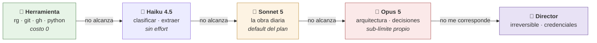

# MODEL_ROUTING.md — A quién se le da cada trabajo

| Campo | Valor |
|---|---|
| Propósito | Decidir sin pensarlo qué modelo, qué agente y qué herramienta atiende cada tarea |
| Fecha | 2026-09-15 |
| Versión | 1.0 |
| Clasificación | INTERNO |
| Estado | VERIFIED — disponibilidad de modelos y costos medidos en esta cuenta |
| Relaciones | ADR-0001 · ADR-0002 · `COST_MODEL.md` · `ARCHITECTURE.md` §4 |

---

## Esto no es un programa

No hay router que escribir. **Una suscripción no es una API key: no hay nada que rutear por código.** El cambio de modelo ocurre con `/model`, con el campo `model:` del frontmatter de un subagente, y con los niveles de effort.

Así que el router es **una tabla de decisión escrita más configuración nativa**. Esta es la tabla.

> *Analogía de obra:* no se contrata al ingeniero jefe para replantear una medianera. Cada tarea va al oficio más barato que la resuelva bien, y se escala solo cuando el trabajo lo pide.

## La escalera de costo

> **Se sube un escalón solo cuando el anterior falló o es demostrablemente insuficiente.** Nunca al revés: no se arranca arriba "por las dudas".

## Qué hay disponible en este plan

| Modelo | ID | Contexto útil | En Claude Pro |
|---|---|---|---|
| **Sonnet 5** | `claude-sonnet-5` | 1M nativo | ✅ **default de Claude Code** |
| **Opus 5** | `claude-opus-5` | **200K efectivos** | ✅ el más fuerte del plan |
| **Haiku 4.5** | `claude-haiku-4-5` | 200K | ✅ sin soporte de effort |
| Fable 5 / 5.1 | — | — | ❌ requiere usage credits |
| Contexto 1M en Opus | — | — | ❌ requiere usage credits |
| Fast mode | — | — | ❌ requiere usage credits |

**Diseñar para 200K de contexto efectivo con Opus.** No es cuota: es un chequeo de habilitación. Si el contexto pasa de 200K, Claude Code compacta.

**Alerta de mantenimiento:** no pinear Haiku ni Sonnet con fecha completa — tienen retiros tentativos próximos. Usar los alias de familia.

## Tabla de asignación

| Trabajo | Va a | Por qué |
|---|---|---|
| Buscar texto, contar, mover, versionar, formatear, medir | **Herramienta** | Determinista, exacto, cero tokens. `ripgrep` no alucina |
| Clasificar, extraer campos, resumir un documento corto, renombrar | **Haiku 4.5** | Barato. No le pidas razonamiento: no soporta effort |
| Escribir, editar, investigar, documentar — la obra diaria | **Sonnet 5** | Default del plan, 1M nativo sin credits |
| Arquitectura, trade-offs, depuración difícil, revisión adversarial | **Opus 5** + effort `high`/`xhigh` | El más fuerte disponible, con sub-límite propio: recurso escaso |
| Autenticación, credenciales, compras, BIOS, borrados, publicar | **Director** | Irreversible o fuera de mi alcance |

### Effort

Los tokens de razonamiento **se facturan como salida**, y el presupuesto por defecto puede ser de decenas de miles por pedido.

| Nivel | Cuándo |
|---|---|
| `low` | Etapas mecánicas, transformaciones, formateo |
| `high` (default) | La mayor parte del trabajo |
| `xhigh` / `max` | Solo decisiones difíciles y verificación adversarial |

## Los subagentes

Tres, y la división **no es por tema sino por riesgo** — es el control de seguridad principal del sistema (ADR-0006), hecho configuración:

| Agente | Herramientas | Modelo | Qué puede hacer |
|---|---|---|---|
| **`investigador`** | WebSearch, WebFetch, Read, Grep, Glob | haiku | Lee el mundo exterior. **Sin escritura, sin shell, sin credenciales** |
| **`critico`** | Read, Grep, Glob, WebFetch | sonnet | Intenta refutar. Solo lectura |
| **`ejecutor`** | Read, Write, Edit, Glob, Grep, Bash | sonnet | Cambia el repositorio. **No navega ni lee correo** |

El que lee contenido no confiable **no tiene con qué hacer daño**. El que puede hacer daño **no consume contenido no confiable**. El orquestador —la sesión con el Director— es el único que ve las dos cosas, y es el que tiene un humano mirando.

## Cuándo paralelizar, y cuándo no

| Situación | Decisión |
|---|---|
| Investigación de lectura, ramas independientes, tema ancho | **Fan-out acotado** |
| Verificación adversarial de un hallazgo de alto impacto | Fan-out chico (2–3 críticos) |
| Trabajo con estado compartido (escribir código, editar el mismo archivo) | **Nunca** |
| Tema angosto que resuelven tres búsquedas | **Nunca** |

**Costos medidos** (`COST_MODEL.md`):

| | Costo |
|---|---|
| Fan-out **sin tope**, 15 agentes | **14 % del semanal** — entran 7 por semana |
| Fan-out **con tope**, 6 agentes | 9 % del semanal |
| Fase de construcción determinista | **0 %** |

**Todo fan-out declara antes**: cuántos agentes, cuántas recuperaciones web como máximo, cuántos hallazgos. Sin tope, no se lanza. Agent teams quedan deshabilitados (~7x).

## Ruteo por clasificación de datos

Antes de elegir modelo, mirar **qué dato se toca**:

| Clase | Dónde puede ir |
|---|---|
| 🔴 `PERSONAL` — finanzas, legales, correo, salud, campo, credenciales | **Solo Claude.** Nunca a un tier gratuito de terceros |
| 🟡 `INTERNO` — notas, borradores, código propio | Claude; terceros solo anonimizado y con decisión explícita |
| 🟢 `PÚBLICO` — documentación, artículos, open source | Cualquier modelo |

**Sin clase declarada, se asume `PERSONAL`.** El motivo es literal: los términos del tier gratuito de Gemini permiten que Google use los prompts para mejorar sus productos y que revisores humanos los lean.

## Escalar solo con motivo

Se sube de escalón cuando pasa **algo de esto**, no antes:

1. El escalón anterior **falló** y se sabe por qué.
2. La tarea exige razonamiento sobre trade-offs, no ejecución.
3. El costo de equivocarse es alto y difícil de revertir.

Y se **baja** apenas se pueda: una vez tomada la decisión difícil, la ejecución vuelve al escalón barato.

## Cuándo revisar este documento

- Si cambia el plan del Director (Max habilitaría Fable y el contexto de 1M).
- Si Anthropic retira o agrega modelos.
- En la Fase 9, con datos de uso reales por componente (`/usage` los atribuye).
