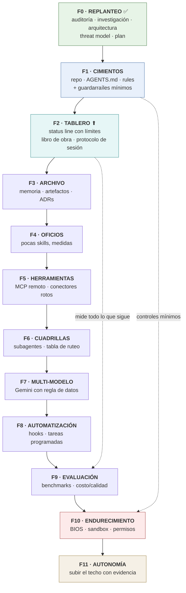

# ROADMAP.md — Bruno AI OS

| Campo | Valor |
|---|---|
| Propósito | Plan de fases derivado de la auditoría y la investigación |
| Fecha | 2026-09-16 |
| Versión | 1.1 — aprobada y en ejecución |
| Estado | Fases 0 a 10 cerradas · Fase 11 en curso. El avance real, con evidencia por entregable, vive en `PROGRESS.md` |

---

## 1. Una desviación propuesta, y por qué

> **Aprobadas el 2026-09-14, las dos.** Lo que sigue es el razonamiento original, conservado como registro de por qué el orden terminó siendo el que es.

El mandato fija en §18 y §38 una secuencia de 11 fases. **Se propusieron dos cambios de orden**, con la evidencia que los justifica.

### Cambio 1 — La medición sube de la fase 9 a la fase 2

El mandato pone *Evaluation* en la fase 9. La auditoría demostró que **el presupuesto de tokens es el recurso escaso del sistema**, y la propia Fase 0 lo confirmó agotando la ventana de 5 horas del plan.

> Construir nueve fases sin medir consumo, en un plan que ya se satura, es empezar la obra sin saber cuánto material hay en el corralón.

La medición además es **barata y ya existe**: la status line recibe `rate_limits.five_hour` y `rate_limits.seven_day`, y `/usage` atribuye consumo por skill, subagente, plugin y servidor MCP. No hay que construir telemetría: hay que conectarla.

### Cambio 2 — Los controles mínimos de seguridad bajan de la fase 10 a la fase 1

El mandato pone *Security/Hardening* en la fase 10. Pero **hoy no existe ningún aislamiento** y el token de GitHub ya es un canal de exfiltración funcional. Cuatro controles cuestan menos de una hora y protegen todas las fases siguientes: `gitleaks` en pre-commit, `.gitignore` estricto, backup por `git bundle`, y la política de clasificación de datos.

> El casco y el arnés se ponen antes de subir al andamio, no en la última etapa de la obra.

Lo que **permanece** en la fase de endurecimiento es lo estructural: BIOS, sandbox, segunda cuenta de Windows, revisión de permisos.

### Lo que no cambia

El resto del orden se respeta: cimientos → capacidades → memoria → herramientas → agentes → ruteo → multi-modelo → automatización → evaluación → endurecimiento → autonomía. Y el ciclo interno de cada fase sigue siendo **BUILD → TEST → REVIEW → FIX → DOCUMENT**, con checkpoint, Mermaid, reporte conceptual y autorización entre fases.

---

## 2. Secuencia propuesta

⬆ = fase adelantada respecto del mandato original.

---

## 3. Detalle de fases

### F0 — REPLANTEO ✅ COMPLETA

Auditoría del entorno · investigación verificada de 9 dominios · auditoría del ecosistema GitHub · arquitectura · threat model · plan de fases · primeros diagramas.
**Entregables:** `SYSTEM_AUDIT.md`, `docs/research/FINDINGS.md` + 9 JSON crudos, `ARCHITECTURE.md`, `docs/security/THREAT_MODEL.md`, `ROADMAP.md`, ADR-0001 a 0006, `PROGRESS.md`.

---

### F1 — CIMIENTOS · *el pliego y el vallado mínimo*

**Qué se construye**
- Repositorio en `<carpeta-del-proyecto>`, con git inicializado y espejo privado en GitHub.
- **Mudanza del trabajo de Fase 0** desde el workspace efímero. Cierra el riesgo R7.
- `AGENTS.md` canónico + `CLAUDE.md` puntero + estructura de directorios.
- `.claude/rules/` con las primeras reglas condicionales por `paths:`.
- `.gitignore` estricto · `gitleaks` en hook `pre-commit` · primer `git bundle`.
- `docs/decisions/` con los ADRs de Fase 0.
- Política de clasificación de datos operativa.

**Cómo se verifica:** un commit con un secreto de prueba es bloqueado por el hook · el bundle restaura en carpeta temporal · una sesión nueva lee el contrato sin que el Director explique nada.

**Cierra además:** las preguntas Q1, Q6 y Q8 de `FINDINGS.md`, con pruebas de cinco minutos.

**Requiere del Director:** elegir carpeta definitiva · autorizar la creación del repo en GitHub.

---

### F2 — TABLERO ⬆ · *saber cuánto se gasta*

**Qué se construye**
- Status line que muestra el porcentaje consumido de la ventana de 5 horas y de la semanal.
- `logs/` como libro de obra: qué tarea, qué modelo, qué costó, qué salió, si hubo intervención humana.
- Protocolo de sesión escrito y adoptado: ráfagas de menos de una hora, `/clear` + `HANDOFF.md`, orden estable→volátil.
- Línea base de consumo: qué cuesta hoy una sesión típica.

**Cómo se verifica:** la status line refleja lo mismo que `/usage` · existe una línea base numérica contra la cual comparar.

**Por qué acá:** todo lo que se construya después se va a poder justificar con números en vez de con opinión.

---

### F3 — ARCHIVO DE OBRA · *que lo aprendido sobreviva*

Convenciones de memoria (`user` / `feedback` / `project` / `reference`) con el índice bajo el tope de 200 líneas · convención de artefactos con propósito, fecha, versión, clasificación, fuentes y estado · plantilla de ADR · `HANDOFF.md`.

**Cómo se verifica:** una sesión nueva retoma un trabajo interrumpido leyendo solo el handoff, y se mide cuánto contexto costó frente a reconstruirlo.

---

### F4 — OFICIOS · *pocas skills, y que se note*

Del catálogo del mandato (§12), **solo las que se justifiquen por reutilización real**. Cada skill nueva es un impuesto fijo sobre cada sesión, porque las descripciones están siempre en contexto.

**Primer paso obligatorio:** auditar los 7 plugins ya instalados con 0 usos y las 3 skills propias del Director. Es más barato usar lo que ya está que crear algo nuevo.

**Candidatas iniciales** (a confirmar con evidencia, no con el catálogo): investigación con artefacto, explicación de conceptos con Mermaid, control de calidad de entregables, gestión del archivo de obra.

**Cómo se verifica:** con `claude plugin eval` — brazo con-skill contra brazo baseline. Si una skill no mejora el baseline de forma medible, **no entra**.

**Nota:** `plan-before-build`, que el Director ya usa, se integra en vez de duplicarse.

---

### F5 — HERRAMIENTAS · *conectar sin instalar*

- Reemplazo de los 4 conectores rotos por MCP remoto con token estático, empezando por GitHub.
- Evaluación de `mcp-server-fetch` (pip, versión pineada) como alternativa barata a WebFetch.
- **Decisión sobre `uv`**: binario estático sin admin que desbloquea el catálogo MCP de Python. La instalación de mayor palanca de la auditoría; se decide con un caso de uso concreto, no "por las dudas".
- Checklist de admisión de MCP y skills (V2 y V3 del threat model).

**Cómo se verifica:** el conector de GitHub responde por la vía nueva · ningún componente nuevo entra sin pasar el checklist.

---

### F6 — CUADRILLAS · *subagentes y ruteo*

Subagentes mínimos con **separación de roles del threat model**: el lector no tiene credenciales; el ejecutor no lee contenido externo. Tabla de ruteo operativa. Configuración de modelos y effort.

**Cómo se verifica:** una tarea de investigación produce artefacto sin que el agente lector tenga acceso a tokens · el costo se compara contra la línea base de F2.

---

### F7 — MULTI-MODELO · *solo donde hay ventaja*

**Precondición dura:** la regla de clasificación de datos está activa. Gemini gratuito **nunca** toca datos PERSONAL.

Vía preferida sin Node: `pip install llm` con plugin de Gemini. Alternativa: Antigravity CLI (`agy`, binario Go). Gemini CLI queda descartado: exige Node.js 20+.

De OpenAI solo entra `AGENTS.md`, que ya se adopta en F1 con costo cero.

**Cómo se verifica:** una tarea concreta muestra ventaja medible frente a hacerla solo con Claude. **Si no la muestra, no se integra.** Esto es un experimento, no un objetivo.

---

### F8 — AUTOMATIZACIÓN · *lo repetitivo, sin vigilancia*

Hooks deterministas (en Python, porque no hay `jq`) y tareas programadas. Solo sobre lo ya probado a mano.

**Restricción del threat model:** ninguna tarea desatendida que procese contenido externo sin revisión. Y advertencia conocida en Windows: ventanas de consola que roban el foco en cada llamada a Bash/PowerShell degradan la automatización desatendida en escritorio.

---

### F9 — EVALUACIÓN · *¿esto sirve?*

Benchmarks sobre las dimensiones del mandato §25 (investigación, software, ruteo, contexto, memoria, artefactos, seguridad, autonomía), contra la línea base de F2. Decisión documentada sobre qué se conserva, qué se simplifica y qué se descarta.

---

### F10 — ENDURECIMIENTO · *el vallado de verdad*

Las tres decisiones de `THREAT_MODEL.md` §7: `bypassPermissions`, virtualización en BIOS, alcance del token de GitHub. Más segunda cuenta de Windows si se justifica, y revisión completa de permisos.

---

### F11 — AUTONOMÍA · *subir el techo, con evidencia*

Ampliar lo que el sistema hace sin preguntar, **solo sobre categorías con historial medido de éxito**. Nunca por defecto y nunca sobre acciones irreversibles.

---

## 4. Criterios de "listo" por fase

Una fase se cierra cuando, y solo cuando:

1. Lo construido **funciona y está probado** — no "implementado".
2. La documentación está actualizada.
3. Hay un Mermaid del estado.
4. Los riesgos nuevos están registrados.
5. `PROGRESS.md` refleja la realidad.
6. Todo está commiteado.
7. ~~El Director autorizó la siguiente.~~ **Derogado el 2026-09-15:** el Director levantó la parada entre fases y el trabajo pasó a modo continuo. Se sigue frenando ante lo irreversible, las credenciales y lo que solo puede hacer él.

Estados permitidos en los reportes: **`VERIFIED` · `PARTIALLY VERIFIED` · `ASSUMED` · `BLOCKED`**. Nada de "implementado" sin evidencia.

---

## 5. Riesgos del plan

| # | Riesgo | Mitigación |
|---|---|---|
| RP1 | El presupuesto se agota antes de terminar | Fase 2 adelantada · presupuesto declarado por fase · regla de multiagente |
| RP2 | Crecimiento por acumulación: muchas skills, muchos MCP | Cada componente entra solo si mejora un baseline medido |
| RP3 | Sesiones largas que se compactan y pierden estado | `/clear` + `HANDOFF.md` como protocolo, no como sugerencia |
| RP4 | Cambios de plataforma (modelos retirados, features movidas) | `ARCHITECTURE_EVOLUTION.md` · no pinear modelos con fecha completa |
| RP5 | El Director no puede operar lo construido | Cada fase termina con una prueba en lenguaje natural |
| RP6 | Fases tardías que nunca llegan | F7 a F11 son opcionales por diseño: el sistema es útil desde F4 |
